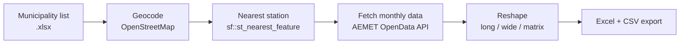

# AEMET Climate Data Dashboard

An interactive R Shiny app that turns Spain's national weather service open data (AEMET) into analysis ready tables for any list of municipalities, with no code required from the user.

Upload a spreadsheet of municipalities, and the app geocodes them, matches each to its nearest AEMET weather station, pulls monthly climate records for the years you choose, and exports tidy Excel workbooks.

<!-- TODO: add 2-3 screenshots to docs/images/ and embed them here, e.g.

-->

## Why I built it

I built this during my internship at Fundación RIA, where I designed a geospatial analysis framework in R and Python to make environmental data more accessible to architects. Getting climate records out of AEMET normally means API calls, station lookups and reshaping data by hand. This app wraps that whole workflow in a 4 step interface so people who don't code can get the data they need.

## What it does

| Step | Tab | What happens |
|---|---|---|
| 1 | **Setup** | Connect with your AEMET API key, choose one of 24 AEMET monthly variables (precipitation, temperature, humidity, pressure, wind, …), upload a municipality list |
| 2 | **Stations** | Geocode each municipality via OpenStreetMap, match it to the nearest AEMET station, inspect the matches on a Leaflet map and in a table |
| 3 | **Data** | Choose stations and a year range, fetch the data from AEMET, preview faceted time series |
| 4 | **Export** | Download an Excel workbook and the table of stations as CSV |



### Output workbook

| Sheet | Shape | Use |
|---|---|---|
| `station_month_matrix` | one row per month, one column per station | quick charting in Excel |
| `wide` | one row per station × year, Jan–Dec columns plus yearly max / min / mean / sum | comparing years |
| `long` | one row per station × month | tidy format for R, Python, QGIS |

## Technical notes

- **Spatial matching.** Municipalities are converted to `sf` points and assigned to the nearest station with `st_nearest_feature()`. Distances are reported in km and colour coded in the results table, so a geocoding error (a distance above 40 km, say) is easy to spot.
- **Robust to incomplete data.** Partial years used to crash the wide format reshape silently. The app now backfills missing month columns with `NA` and wraps each station request in `tryCatch()`, so one failing station is logged as a warning and the rest still load.
- **Mixed data types.** Most AEMET variables are numeric, but `w_racha` (maximum gust) is a composite string. The app detects this, keeps it as text and skips the numeric summaries and plot.
- **API etiquette.** AEMET allows 50 requests per minute, so requests are paced with a short delay and progress is shown per station.
- **No secrets in code.** The API key comes from an environment variable or is typed into the app and held in memory for the session only.
- 

### Municipality file format

An `.xlsx` file with three columns. For example:

| NOMECAPITA | CONCELLO | PROVINCIA |
|---|---|---|
| Santiago de Compostela | Santiago de Compostela | A Coruña |

`CONCELLO` is the municipality (Galician *concello*), `NOMECAPITA` is its administrative seat, and `PROVINCIA` is one of A Coruña, Lugo, Ourense or Pontevedra. A small example template is included in [`data/example_municipalities.xlsx`](data/example_municipalities.xlsx).


## Visualization
[AEMET-visualization](AEMET_visualization.ipynb): Python analysis of long term temperature and rainfall trends in Galicia using the same AEMET data.
<p align="center">
    
    
    
    
<p/>

## Getting started

**Requirements:** a recent version of R and a free [AEMET OpenData API key](https://opendata.aemet.es/centrodedescargas/altaUsuario).

```r
# 1. Install the packages (once)
source("install_packages.R")

# 2. Provide your key, either:
#    a) copy .Renviron.example to .Renviron, add your key, restart R, or
#    b) paste it into the Setup tab when the app opens

# 3. Run the app
shiny::runApp()
```

## Deploying your own copy (optional)

The app asks each visitor for their own AEMET key, so a public deployment doesn't need any secrets on the server. A free [shinyapps.io](https://www.shinyapps.io) account is enough:

```r
install.packages("rsconnect")
rsconnect::setAccountInfo(name = "<account>", token = "<token>", secret = "<secret>")  # from your shinyapps.io dashboard
library(rsconnect)
rsconnect::deployApp('path/to/your/app')
```

## Limitations

- Station matching uses straight line distance and ignores elevation and terrain. A nearby station isn't always the most climatically representative one.
- Geocoding relies on the public OpenStreetMap Nominatim service, so large lists are slow and misspelled names can fail.
- The API key is stored in the R process's environment. On a shared server hosting several simultaneous users, concurrent sessions would share it.
- Not every station records every variable or year. Gaps are reported in the app and left as `NA` in the export.

## Data sources and attribution
- Climate data: © [AEMET](https://opendata.aemet.es/) (Agencia Estatal de Meteorología). Please follow AEMET's reuse and attribution terms.
- Geocoding and base map: © [OpenStreetMap](https://www.openstreetmap.org/copyright) contributors; map tiles by CARTO.

## License
[MIT](LICENSE) © 2026 Madeline LeBreton
